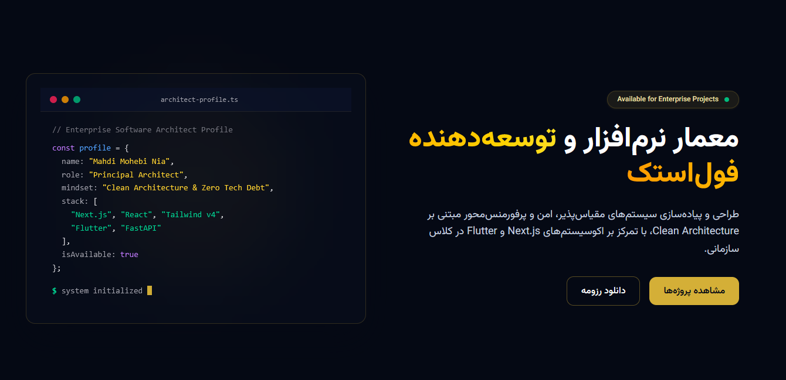
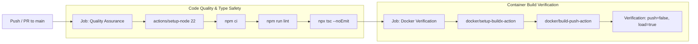

<div align="center">
  <a href="https://mahdi-portfolio-cyan.vercel.app/" target="_blank">
    
  </a>
  <br />
  <h2>🌐 <a href="https://mahdi-portfolio-cyan.vercel.app/" target="_blank">VIEW LIVE ENTERPRISE PORTFOLIO</a></h2>
</div>

<h1 align="center">Mahdi Mohebi Nia | Enterprise Portfolio & Platform</h1>

<h3 align="center"><i>Architecting Scalable, Zero-Debt Enterprise Solutions</i></h3>

<div align="center">
  <a href="https://mahdi-portfolio-cyan.vercel.app/"></a>
  <a href="https://github.com/mahdimohebiizm-stack/mahdi-portfolio/actions"></a>
  <a href="#"></a>
</div>
<br/>

> **Executive Summary:** An enterprise-grade, high-performance personal platform engineered with Next.js 16 App Router, React 19 Server Components, Tailwind CSS v4, and a dynamic 5-locale architecture. Built strictly on the Zero Technical Debt paradigm.

<div align="center">
  <br />
  <a href="#english-version"><strong>🇺🇸 Read Documentation in English</strong></a>
  &nbsp; | &nbsp;
  <a href="#persian-version"><strong>🇮🇷 مطالعه مستندات معماری به زبان فارسی</strong></a>
  <br /><br />
</div>

<a name="english-version"></a>

---

## 1. Architectural Philosophy

This repository is engineered with a focus on high runtime performance, strict type safety, and predictable deployments:

* **Zero-Debt Architecture:** Elimination of `TODO` placeholders, strict avoidance of the `any` type, and end-to-end schema validation.
* **Component-Driven Development:** Clear separation between reusable atomic primitives (`components/ui/`), animation wrappers (`components/ui/motion/`), and domain section views (`components/sections/`).
* **Server-First Execution:** React Server Components by default to minimize client bundle size. Client Components (`"use client"`) are isolated to interactive leaves.
* **Dual-Layer Validation:** Client-side validation for instant user feedback paired with server-side validation inside Server Actions using a shared Zod schema.
* **Native Zero-Dependency 5-Language i18n:** Lightweight routing supporting Persian (`fa`), English (`en`), Arabic (`ar`), Chinese (`zh`), and Russian (`ru`) using App Router dynamics, locale cookies, and native dictionary imports without heavy external dependencies.
* **Bidirectional Layout Engineering:** Native RTL flow for Persian and Arabic via Google Fonts (`Vazirmatn`) and Tailwind CSS logical properties, with explicit LTR containment for code blocks and email fields.
* **Premium Enterprise Visual Identity:** Custom Navy (`#0B132B`) and Gold (`#D4AF37`) palette with hardware-accelerated Glassmorphism.

---

## 2. Technology Stack & Specifications

### Core Framework & UI
| Layer | Technology | Specification / Role |
| :--- | :--- | :--- |
| **Framework** | Next.js 16.4.3 | App Router, Dynamic Routes `[lang]`, Cache Components, PPR |
| **Library** | React 19.3.0 | Server Components, `useActionState`, Transitions |
| **Styling** | Tailwind CSS v4 | Engine-level `@theme` tokens, `@tailwindcss/postcss`, Webpack |
| **Typography** | Vazirmatn | `next/font/google`, Subsets: Arabic, Latin with system fallbacks |
| **Animations** | Framer Motion | Orchestrated entrances & scroll-reveal transitions |
| **Language** | TypeScript 5.x | Strict mode enabled (`strict: true`, `noImplicitAny: true`) |

### Localization, State, Validation & Server Actions
| Layer | Technology | Specification / Role |
| :--- | :--- | :--- |
| **i18n Engine** | Native Dynamic Routing | JSON Dictionaries, locale negotiation, `generateStaticParams` |
| **Validation** | Zod 4.x | Shared schema validation across client and server |
| **Form Management**| React Hook Form | Uncontrolled form inputs with `@hookform/resolvers/zod` |
| **Server Logic** | Server Actions | Backend execution via Next.js `"use server"` |
| **Email Service** | Resend API SDK | Transactional email forwarding with responsive dark-mode HTML |

### Infrastructure, PWA & SEO
| Layer | Technology | Specification / Role |
| :--- | :--- | :--- |
| **PWA Engine** | Serwist 9.5.x | Service Worker runtime, pre-caching, and offline fallbacks |
| **Manifest** | Web App Manifest | Standalone display mode, directional metadata, maskable icons |
| **Search Engine** | Metadata API | Localized Next.js `Viewport` and `Metadata` (OpenGraph & Twitter Cards) |
| **Crawlers** | `robots.ts` / `sitemap.ts` | Multi-locale dynamic XML Sitemap and crawler directives |

### DevOps & Containerization
| Layer | Technology | Specification / Role |
| :--- | :--- | :--- |
| **Container Engine**| Docker | 3-stage multi-stage build (`node:22-alpine`) |
| **Output Mode** | Next.js Standalone | Standalone server build for Docker, serverless output for Vercel |
| **Process Security**| Non-Root User | Runs under non-root system account `nextjs:nodejs` (UID 1001) |
| **Continuous Integration** | GitHub Actions | Automated linting, type-checking, and container build verification |

---

## 3. Repository Structure

```text
mahdi-portfolio/
├── .github/
│   └── workflows/
│       └── ci.yml                 # Automated CI quality and Docker build pipeline
├── app/
│   ├── [lang]/
│   │   ├── layout.tsx             # Localized root layout with dynamic lang & dir
│   │   └── page.tsx               # Server-First page assembling localized sections
│   ├── actions/
│   │   └── contact.ts             # Server Action with Resend SDK & Zod validation
│   ├── globals.css                # Tailwind v4 @theme design tokens and baseline rules
│   ├── robots.ts                  # Dynamic crawler directives
│   ├── sitemap.ts                 # Dynamic XML sitemap generator (5 locales)
│   └── sw.ts                      # Serwist Service Worker source definition
├── components/
│   ├── layout/
│   │   ├── Navbar.tsx             # Navigation header with LanguageSwitcher
│   │   └── Footer.tsx             # Semantic server-rendered footer
│   ├── sections/
│   │   ├── Contact.tsx            # Form utilizing useActionState & RHF
│   │   ├── Hero.tsx               # Introduction with LTR terminal simulation
│   │   ├── Projects.tsx           # Showcase mapping verified engineering experience
│   │   └── Skills.tsx             # Domain-categorized expertise with SVG badges
│   └── ui/
│       ├── motion/
│       │   ├── FadeInScale.tsx    # Hardware-accelerated scale entrance
│       │   ├── FadeInUp.tsx       # Smooth scroll-reveal motion wrapper
│       │   └── StaggerContainer.tsx# Orchestrated child animation container
│       ├── Button.tsx             # Scalable button primitive (Primary / Outline)
│       ├── Container.tsx          # Max-width layout boundary container
│       ├── GlassCard.tsx          # High-performance glassmorphism card
│       ├── LanguageSwitcher.tsx   # Sleek glassmorphic 5-language dropdown
│       └── SectionHeader.tsx      # Typographic header with gold accent underline
├── dictionaries/
│   ├── ar.json                    # Arabic dictionary
│   ├── en.json                    # English dictionary
│   ├── fa.json                    # Original base dictionary
│   ├── ru.json                    # Russian dictionary
│   └── zh.json                    # Chinese dictionary
├── lib/
│   ├── dictionary.ts              # Type-safe dynamic dictionary loader
│   ├── i18n.ts                    # Locales, RTL metadata, and language configurations
│   └── validations/
│       └── contact.ts             # Inferred Zod schema and TypeScript contract
├── public/
│   ├── manifest.json              # Web App Manifest configured for standalone mode
│   └── sw.js                      # Compiled production Service Worker
├── .dockerignore                  # Build context exclusion rules
├── Dockerfile                     # Multi-stage production container specification
├── eslint.config.mjs              # Flat ESLint configuration with selective ignores
├── middleware.ts                  # High-performance locale routing and negotiation
├── next.config.ts                 # Next.js configuration with Serwist & Webpack
├── package.json                   # Project dependencies and script declarations
└── tsconfig.json                  # Compiler options enforcing strict type evaluation
```

---

## 4. Architectural Patterns

### Native Zero-Dependency i18n System
Rather than injecting bulky third-party libraries that bloat client bundles and introduce hydration overhead, the platform utilizes Next.js dynamic routing (`app/[lang]`):
1. **Routing & Negotiation (`middleware.ts`):** Intercepts requests, inspects `NEXT_LOCALE` cookie and `Accept-Language` headers, and routes cleanly to `/${locale}` while bypassing static assets and PWA files.
2. **Server-Side Dictionary Loading (`lib/dictionary.ts`):** Asynchronously imports only the JSON dictionary required for the active locale on the server, streaming static HTML with zero client JS dictionary overhead.
3. **Glassmorphic Language Switcher (`LanguageSwitcher.tsx`):** A lightweight client dropdown that preserves user selections via cookies, updates the route segment, and closes smoothly on outside click.

### Atomic UI System
The visual architecture follows a Component-Driven approach:
* **Structural Containers (`Container.tsx`):** Enforces a responsive boundary (`max-w-7xl mx-auto px-6 lg:px-8`) across all desktop and mobile viewports.
* **Glassmorphic Substrates (`GlassCard.tsx`):** Employs hardware-accelerated backdrop blur (`backdrop-blur-md`) with low-opacity navy surfaces (`bg-navy-light/10`) and gold border transitions on hover.
* **Typography & Accents (`SectionHeader.tsx`):** Automatically formats headers and styles designated accent words alongside a directional underline accent.

### Bidirectional Layout Isolation
While the document dynamically switches `dir="rtl"` (for Persian and Arabic) and `dir="ltr"` (for English, Chinese, and Russian), technical code blocks—such as the simulated terminal in `Hero.tsx` and email inputs in `Contact.tsx`—are explicitly wrapped with `dir="ltr"` and `text-left`. This prevents bidirectional punctuation inversion and guarantees correct syntax rendering.

### Secure Server Actions & Dual-Layer Validation
The application avoids generic REST endpoints for form submissions in favor of Next.js Server Actions:
1. **Client Tier:** `Contact.tsx` registers inputs via `react-hook-form` and validates synchronously using `zodResolver(localizedSchema)`. No network traffic occurs if validation fails.
2. **Server Tier:** `submitContactForm` in `app/actions/contact.ts` intercepts the raw `FormData` and executes `contactSchema.safeParse`. Client assertions are treated as untrusted; if data tampering occurs, structured field errors are returned.
3. **Resend Email Integration:** Validated submissions are formatted into an RTL HTML email template and forwarded through the Resend API, protecting environment secrets and avoiding leaking server stacks.

---

## 5. Enterprise PWA & SEO Architecture

* **Pre-caching & Offline Resilience:** Leveraging Serwist, static build assets, font bundles, and core JavaScript chunks are cached inside CacheStorage. When the device experiences network loss, cached assets remain accessible.
* **Multi-Locale Web App Manifest:** Configured with `display: "standalone"`, and dedicated background and theme colors (`#050914` and `#0B132B`) to deliver a native PWA installation experience on Android and iOS.
* **Typed SEO & Social Graph:** The application exports localized Next.js `Viewport` and `Metadata` objects containing canonical URLs (`metadataBase`), OpenGraph specifications for all 5 languages, Twitter Large Image cards, and Apple Web App meta directives.
* **Dynamic Sitemap:** `app/sitemap.ts` generates structured XML sitemaps covering all 5 locale paths (`/fa`, `/en`, `/ar`, `/zh`, `/ru`).

---

## 6. Getting Started (Local Development)

### Prerequisites
* **Node.js:** `^22.0.0`
* **Package Manager:** `npm` (`v10+`)

### Installation & Execution
Always use `npm ci` rather than `npm install` to guarantee deterministic dependency resolution identical to the lockfile:

```bash
# 1. Clone the repository
git clone https://github.com/mahdimohebinia/mahdi-portfolio.git
cd mahdi-portfolio

# 2. Install dependencies deterministically
npm ci

# 3. Configure environment variables (.env.local)
cp .env.example .env.local

# 4. Start the development server
npm run dev
```

Open [http://localhost:3000](http://localhost:3000) in your browser.

### Quality Assurance & Verification
Run the strict verification suite locally before committing:

```bash
# Execute ESLint static analysis
npm run lint

# Execute strict TypeScript type validation
npx tsc --noEmit

# Execute production build with Webpack & Service Worker generation
npm run build
```

---

## 7. Docker & Production Deployment

The project features a hardened, 3-stage `Dockerfile` designed for production deployments.

### Why `output: "standalone"`?
By setting `output: "standalone"` dynamically for non-Vercel environments, Next.js analyzes the AST of the codebase and traces only the files, packages, and `node_modules` strictly required to execute the server. This reduces the deployment footprint from over 800MB to under 150MB, significantly improving container startup time and reducing the attack surface.

### Container Build & Run

```bash
# 1. Build the production Docker image
docker build -t mahdi-portfolio .

# 2. Run the container as an isolated daemon
docker run -d \
  --name portfolio-app \
  -p 3000:3000 \
  --restart unless-stopped \
  mahdi-portfolio
```

Access the production instance at `http://localhost:3000`.

### Container Security Specifications
* **Minimal Base Image:** Uses `node:22-alpine` to minimize CVE exposure.
* **Unprivileged User:** The application runs under user `nextjs` (UID 1001) and group `nodejs` (GID 1001). Root execution is strictly prohibited.
* **Static Assets Isolation:** Public assets and `.next/static` traces are mapped to the standalone runtime directory with deterministic ownership permissions.

---

## 8. Continuous Integration (CI) Pipeline

Automated checks are executed via GitHub Actions (`.github/workflows/ci.yml`) on every pull request and push to the `main` branch:



---

## 9. License

This project is licensed under the [MIT License](LICENSE). Engineered by **Mahdi Mohebi Nia**.

---

<a name="persian-version"></a>
## 🇮🇷 راهنمای فارسی (Persian Architectural Documentation)

پلتفرم شخصی و نمونه‌کارهای مهندسی مهدی محبی‌نیا؛ پیاده‌سازی‌شده با فریمورک Next.js 16 (معماری App Router)، کامپوننت‌های سرور React 19، سیستم استایلینگ Tailwind CSS v4، سیستم بین‌المللی‌سازی ۵ زبانه و قابلیت کارکرد آفلاین (PWA / Offline-First). این پروژه با رعایت اصول Clean Architecture و رویکرد Zero Technical Debt پیاده‌سازی شده است.

---

### ۱. فلسفه و اصول معماری

این مخزن بر پایه اصول استاندارد توسعه نرم‌افزار برای دستیابی به پایداری بالا، تایپ‌سیفتی دقیق و استقرارهای پیش‌بینی‌پذیر طراحی شده است:

* **معماری بدون بدهی فنی (Zero-Debt Architecture):** حذف کدهای موقت (`TODO`)، پرهیز کامل از تایپ any (Strict Typing) و اعتبارسنجی سراسری ورودی‌ها با Zod.
* **توسعه مبتنی بر کامپوننت (Component-Driven):** تفکیک مشخص کامپوننت‌های اتمیک (`components/ui/`)، انیمیشن‌ها (`components/ui/motion/`) و ساختار بخش‌های اصلی صفحه (`components/sections/`).
* **اجرای سرور-محور (Server-First Execution):** استفاده حداکثری از React Server Components برای به حداقل رساندن حجم باندل کلاینت؛ کامپوننت‌های کلاینتی (`"use client"`) صرفاً به لایه‌های نیازمند تعامل کاربر محدود شده‌اند.
* **اعتبارسنجی دو لایه (Dual-Layer Validation):** اعتبارسنجی سمت کلاینت با React Hook Form برای تجربه کاربری روان، در کنار اعتبارسنجی مجدد داده‌ها در سرور اکشن با اسکیمای مشترک Zod.
* **سیستم بین‌المللی‌سازی بومی ۵ زبانه (Native 5-Language i18n):** پشتیبانی از زبان‌های فارسی (`fa`)، انگلیسی (`en`)، عربی (`ar`)، چینی (`zh`) و روسی (`ru`) با استفاده از قابلیت‌های پیش‌فرض App Router و لود پویای فایل‌های JSON بدون تحمیل پکیج‌های حجیم خارجی.
* **پشتیبانی از چیدمان‌های دوجهته (RTL / LTR):** تنظیم جهت سند بر اساس زبان فعال (`rtl` برای فارسی و عربی، `ltr` برای انگلیسی، چینی و روسی) به همراه ایزولاسیون صریح بخش‌های فنی (شبیه‌ساز ترمینال و فیلد ایمیل) در حالت چپ‌به‌راست.
* **هویت بصری مدرن سازمانی:** استفاده از پالت سرمه‌ای (`#0B132B`) و طلایی (`#D4AF37`) در کنار رابط کاربری مدرن بر پایه گلس‌مورفیسمِ بهینه‌شده (Hardware-accelerated).

---

### ۲. مشخصات و پشته فناوری (Tech Stack)

#### فریمورک، کتابخانه‌ها و رابط کاربری
| لایه | فناوری | مشخصات فنی و نقش در معماری |
| :--- | :--- | :--- |
| **فریمورک اصلی** | Next.js 16.4.3 | معماری App Router، مسیرهای داینامیک `[lang]`، کامپوننت‌های کَش، PPR |
| **کتابخانه UI** | React 19.3.0 | کامپوننت‌های سرور، هوک `useActionState`، ری‌اکت Transitions |
| **استایلینگ** | Tailwind CSS v4 | توکن‌های هسته در `@theme`، افزونه `@tailwindcss/postcss`، وب‌پک |
| **تایپوگرافی** | Vazirmatn | فونت بهینه‌شده گوگل با پشتیبانی از گلیف‌های عربی، فارسی و لاتین |
| **انیمیشن‌ها** | Framer Motion | انیمیشن‌های ورود ترتیبی و آشکارسازی هنگام اسکرول |
| **سیستم تایپ** | TypeScript 5.x | فعال بودن حالت سخت‌گیرانه (`strict: true`, `noImplicitAny: true`) |

#### اعتبارسنجی، بین‌المللی‌سازی و سرویس‌ها
| لایه | فناوری | مشخصات فنی و نقش در معماری |
| :--- | :--- | :--- |
| **موتور i18n** | روتینگ داینامیک بومی | دیکشنری‌های JSON، مذاکره هدر `Accept-Language` و `generateStaticParams` |
| **اعتبارسنجی** | Zod 4.x | اسکیمای اشتراکی اعتبارسنجی ورودی‌ها در کلاینت و سرور |
| **مدیریت فرم** | React Hook Form | فیلدهای کنترل‌نشده با رزولور `@hookform/resolvers/zod` |
| **منطق بک‌اند** | Server Actions | اجرای ایمن عملیات سمت سرور با قابلیت `"use server"` |
| **سرویس ایمیل** | Resend SDK | ارسال امن ایمیل با قالب HTML تاریک، راست‌چین و واکنش‌گرا |

#### زیرساخت، وب‌اپلیکیشن پیش‌رونده (PWA) و سئو
| لایه | فناوری | مشخصات فنی و نقش در معماری |
| :--- | :--- | :--- |
| **موتور PWA** | Serwist 9.5.x | سرویس‌ورکر پیشرفته، کَشینگ استاتیک و پشتیبانی از دسترسی در حالت آفلاین |
| **مانیفست وب** | Web App Manifest | پشتیبانی از حالت تمام‌صفحه Standalone، آیکون‌های Maskable و تم اختصاصی |
| **بهینه‌سازی سئو** | Metadata API | تولید تگ‌های متا، کارت‌های گراف باز و توییتر به صورت تفکیک‌شده برای ۵ زبان |
| **موتورهای جستجو**| `sitemap.ts` / `robots.ts` | تولید داینامیک فایل XML نقشه سایت برای تمام لوکال‌ها و دستورالعمل ربات‌ها |

#### دوآپس و کانتینرسازی
| لایه | فناوری | مشخصات فنی و نقش در معماری |
| :--- | :--- | :--- |
| **کانتینر** | Docker | ساخت ۳ مرحله‌ای مینیمال و ایزوله بر پایه `node:22-alpine` |
| **حالت خروجی** | Next.js Standalone | خودکار: Standalone برای داکر و Native Serverless برای استقرار Vercel |
| **امنیت اجرا** | Non-Root User | اجرای کانتینر با دسترسی کاربر غیر ریشه `nextjs:nodejs` (UID 1001) |
| **یکپارچه‌سازی مداوم**| GitHub Actions | اعتبارسنجی خودکار Lint، Type-check و بیلد آزمایشی ایمیج داکر |

---

### ۳. ساختار درختی مخزن

```text
mahdi-portfolio/
├── .github/
│   └── workflows/
│       └── ci.yml                 # پایپ‌لاین کنترل کیفیت و ساخت کانتینر در گیت‌هاب
├── app/
│   ├── [lang]/
│   │   ├── layout.tsx             # چیدمان ریشه با تنظیم داینامیک زبان و جهت سند
│   │   └── page.tsx               # صفحه اصلی سرور-محور مونتاژکننده بخش‌های ترجمه‌شده
│   ├── actions/
│   │   └── contact.ts             # سرور اکشن ارسال ایمیل با Resend و اعتبارسنجی Zod
│   ├── globals.css                # توکن‌های دیزاین سیستم Tailwind v4 و تنظیمات پایه
│   ├── robots.ts                  # تولید داینامیک دستورالعمل خزنده‌ها (Robots.txt)
│   ├── sitemap.ts                 # تولید سایت‌مپ داینامیک XML برای ۵ زبان
│   └── sw.ts                      # سورس کلاینت سرویس‌ورکر Serwist
├── components/
│   ├── layout/
│   │   ├── Navbar.tsx             # نوبار شیشه‌ای همراه با سلکتور زبان
│   │   └── Footer.tsx             # فوتر سمانتیک سرور رندر با تم Navy & Gold
│   ├── sections/
│   │   ├── Contact.tsx            # فرم تعاملی با هوک useActionState و RHF
│   │   ├── Hero.tsx               # بخش معرفی با شبیه‌ساز ترمینال LTR
│   │   ├── Projects.tsx           # ویترین پروژه‌ها بر اساس سوابق واقعی مهندسی
│   │   └── Skills.tsx             # دسته‌بندی تخصص‌ها در ۳ حوزه با آیکون‌های برداری
│   └── ui/
│       ├── motion/
│       │   ├── FadeInScale.tsx    # انیمیشن ورود مقیاسی شتاب‌یافته
│       │   ├── FadeInUp.tsx       # انیمیشن ورود نرم همراه با اسکرول
│       │   └── StaggerContainer.tsx# کانتینر هماهنگ‌کننده انیمیشن‌های چندگانه
│       ├── Button.tsx             # دکمه پایه اتمیک (Primary و Outline)
│       ├── Container.tsx          # محدودکننده عرض و واکنش‌گرایی محتوا
│       ├── GlassCard.tsx          # کارت شیشه‌ای با افکت بلور سخت‌افزاری
│       ├── LanguageSwitcher.tsx   # منوی دراپ‌داون مدرن انتخاب ۵ زبان
│       └── SectionHeader.tsx      # سرتیتر بخش‌ها با کلمه تأکیدی طلایی
├── dictionaries/
│   ├── ar.json                    # دیکشنری محتوای عربی
│   ├── en.json                    # دیکشنری محتوای انگلیسی
│   ├── fa.json                    # دیکشنری متون پایه (زبان اصلی پروژه)
│   ├── ru.json                    # دیکشنری محتوای روسی
│   └── zh.json                    # دیکشنری محتوای چینی
├── lib/
│   ├── dictionary.ts              # بارگذاری داینامیک و تایپ‌سیف دیکشنری‌ها در سرور
│   ├── i18n.ts                    # متادیتای زبان‌ها، پرچم‌ها و پیکربندی جهت‌ها
│   └── validations/
│       └── contact.ts             # اسکیمای اعتبارسنجی فرم با Zod
├── public/
│   ├── manifest.json              # مانیفست وب‌اپلیکیشن برای نصب PWA
│   └── sw.js                      # فایل کامپایل‌شده سرویس‌ورکر پروداکشن
├── .dockerignore                  # قوانین نادیده‌گیری فایل‌ها در کانتینر
├── Dockerfile                     # فایل مشخصات چندمرحله‌ای ساخت کانتینر
├── eslint.config.mjs              # کانفیگ مدرن فلت ESLint با نادیده‌گیری هوشمند
├── middleware.ts                  # میدلور هوشمند هدایت و مذاکره زبان کاربران
├── next.config.ts                 # کانفیگ Next.js، سازگار با Serwist و Webpack
├── package.json                   # پکیج‌ها و اسکریپت‌های اجرایی پروژه
└── tsconfig.json                  # تنظیمات سخت‌گیرانه کامپایلر تایپ‌اسکریپت
```

---

### ۴. الگوهای پیاده‌سازی و معماری

#### معماری بین‌المللی‌سازی بومی و سبک (Zero-Dependency i18n)
به جای تزریق کتابخانه‌های سنگین خارجی که باندل کلاینت را متورم کرده و مشکل هیدریشن ایجاد می‌کنند، از قابلیت‌های بومی App Router استفاده شده است:
1. **مسیریابی و مذاکره زبان (`middleware.ts`):** درخواست‌های ورودی بررسی می‌شوند؛ ابتدا کوکی `NEXT_LOCALE` و سپس هدر مرورگر `Accept-Language` تحلیل شده و کاربر بدون لود فایل‌های استاتیک به مسیر `/${locale}` هدایت می‌شود.
2. **لود دیکشنری در سمت سرور (`lib/dictionary.ts`):** در سرور تنها فایل JSON زبان درخواستی بارگذاری می‌شود؛ بدین ترتیب کلاینت هیچ سربار اضافی بابت دیکشنری زبان‌های دیگر دریافت نمی‌کند.
3. **انتخاب‌گر زبان شیشه‌ای (`LanguageSwitcher.tsx`):** کامپوننت مینیمال کلاینت که زبان انتخابی را در کوکی ذخیره کرده، مسیر جاری را تغییر می‌دهد و با کلیک به خارج بسته می‌شود.

#### سیستم طراحی اتمیک (Atomic UI)
* **کانتینر ساختاری (`Container.tsx`):** ایجاد حاشیه استاندارد (`max-w-7xl mx-auto px-6 lg:px-8`) در تمامی مانیتورها و تبلت‌ها.
* **بستر شیشه‌ای (`GlassCard.tsx`):** اعمال فیلتر بلور پس‌زمینه (`backdrop-blur-md`) با شتاب‌دهنده سخت‌افزاری بر روی سطوح سرمه‌ای شفاف.
* **تایپوگرافی هوشمند (`SectionHeader.tsx`):** جداسازی خودکار `accentWord` و استایل‌دهی به آن با گرادیان طلایی به همراه خط زیرین جهت‌دار.

#### ایزولاسیون چیدمان‌های دوجهته (Bidirectional Isolation)
با وجود اینکه کل چارچوب به صورت داینامیک بین `rtl` و `ltr` جابجا می‌شود، بخش‌های کدنویسی و فنی—مانند ترمینال تعاملی در بخش Hero و فیلد ورودی ایمیل در فرم تماس—به صورت صریح با `dir="ltr"` و `text-left` مقید شده‌اند تا از برعکس شدن علائم نگارشی و پرانتزها جلوگیری گردد.

#### سرور اکشن‌ها و اعتبارسنجی دو لایه
1. **لایه کلاینت:** فرم در `Contact.tsx` با `react-hook-form` فیلدها را ثبت کرده و با `zodResolver` اعتبارسنجی می‌کند؛ در صورت وجود خطا هیچ ریکوئستی به شبکه ارسال نمی‌شود.
2. **لایه سرور:** تابع `submitContactForm` در سرور اکشن، داده‌ها را مجدداً با اسکیمای Zod اعتبارسنجی می‌کند تا در صورت دور زدن فرانت‌اند، داده نامعتبر نفوذ نکند.
3. **سرویس ایمیل Resend:** پس از تأیید داده‌ها، ایمیل با استایل تیره و راست‌چین سازمانی مستقیماً به صندوق پستی تعیین‌شده فوروارد می‌شود.

---

### ۵. راهنمای اجرا و توسعه محلی

#### پیش‌نیازها
* **Node.js:** نسخه `22.x` به بالا
* **Package Manager:** `npm` نسخه `10.x` به بالا

#### مراحل نصب و اجرا
جهت جلوگیری از ناهماهنگی نسخه‌ها، از دستور `npm ci` استفاده نمایید:

```bash
# ۱. دریافت مخزن پروژه
git clone https://github.com/mahdimohebinia/mahdi-portfolio.git
cd mahdi-portfolio

# ۲. نصب قطعی وابستگی‌ها مطابق با فایل lock
npm ci

# ۳. تنظیم متغیرهای محیطی در فایل .env.local
# RESEND_API_KEY=re_...
# CONTACT_EMAIL=your-email@example.com

# ۴. اجرای سرور توسعه محلی
npm run dev
```

پرتال در نشانی `http://localhost:3000` در دسترس خواهد بود.

#### تست‌های کنترل کیفیت (Quality Assurance)
پیش از ارسال کامیت، دستورات زیر را جهت اطمینان از سلامت پروژه اجرا کنید:

```bash
# بررسی کیفیت کد با لینتر
npm run lint

# بررسی سخت‌گیرانه تایپ‌های تایپ‌اسکریپت
npx tsc --noEmit

# کامپایل پروداکشن پروژه و تولید سرویس‌ورکر PWA
npm run build
```

---

### ۶. ساخت ایمیج داکر و استقرار (Docker)

پروژه دارای یک `Dockerfile` چندمرحله‌ای بهینه‌سازی‌شده برای محیط‌های ابری و سرورهای توزیع‌شده است.

#### ساخت و اجرای کانتینر:

```bash
# ۱. ساخت ایمیج داکر پروداکشن
docker build -t mahdi-portfolio .

# ۲. اجرای کانتینر در پس‌زمینه با پورت ۳۰۰۰
docker run -d \
  --name portfolio-app \
  -p 3000:3000 \
  --restart unless-stopped \
  mahdi-portfolio
```

#### ملاحظات امنیتی داکر:
* استفاده از توزیع فوق‌العاده سبک `node:22-alpine` جهت کاهش سطح آسیب‌پذیری‌های احتمالی (CVE).
* اجرای کامل پروسه بدون دسترسی ریشه با حساب کاربری سیستمی `nextjs:nodejs` (UID 1001).
* کاهش حجم نهایی ایمیج از ۸۰۰ مگابایت به کمتر از ۱۵۰ مگابایت با بهره‌گیری از خروجی Standalone.

---

### ۷. پایپ‌لاین کنترل کیفیت در گیت‌هاب (GitHub Actions CI)

تمام کامیت‌ها و پول‌ریکوئست‌های ارسالی به شاخه `main` به صورت خودکار توسط پایپ‌لاین `.github/workflows/ci.yml` بررسی می‌شوند:
1. ارزیابی استاتیک کد با ESLint
2. اعتبارسنجی کامپایلر تایپ‌اسکریپت (`tsc --noEmit`)
3. آزمایش ساخت موفق ایمیج داکر و خروجی Standalone

---

### ۸. لایسنس

این پروژه تحت مجوز متن‌باز **[MIT License](LICENSE)** منتشر شده است. طراحی و توسعه توسط **مهدی محبی‌نیا**.
