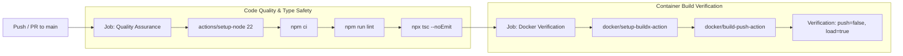

# Mahdi Mohebi Nia | Enterprise Portfolio & Platform

[](https://nextjs.org/)
[](https://react.dev/)
[](https://www.typescriptlang.org/)
[](https://tailwindcss.com/)
[](https://www.docker.com/)
[](https://github.com/)

An enterprise-grade, high-performance personal platform and technical portfolio engineered with Next.js 16 App Router, React 19 Server Components, Tailwind CSS v4, and an Offline-First Progressive Web App (PWA) architecture. The platform adheres strictly to the **Zero Technical Debt** paradigm and Clean Architecture principles.

---

## 1. Architectural Philosophy

The repository was constructed with rigorous engineering standards to guarantee performance, strict type safety, zero runtime errors, and deterministic deployments:

* **Zero-Debt Architecture:** No placeholder code (`TODO`), complete elimination of the `any` type, and strict end-to-end schema validation.
* **Component-Driven Development:** Clear isolation between reusable atomic primitives (`components/ui/`) and orchestrator views (`components/sections/`).
* **Server-First Execution:** Server Components are utilized by default to eliminate client-side JavaScript overhead. Client Components (`"use client"`) are strictly isolated to interactive leaves.
* **Dual-Layer Validation:** Form inputs are validated on the client side for instantaneous feedback and re-validated on the server side inside Server Actions using a shared Zod schema.
* **Native RTL Typography:** Engineered from the ground up for Right-to-Left (Persian) layout flow utilizing Google Fonts (`Vazirmatn`) and Tailwind CSS logical properties.
* **Corporate Luxury Visual Identity:** Custom Navy (`#0B132B`) and Gold (`#D4AF37`) palette with hardware-accelerated Glassmorphism.

---

## 2. Technology Stack & Specifications

### Core Framework & UI
| Layer | Technology | Specification / Role |
| :--- | :--- | :--- |
| **Framework** | Next.js 16.4.3 | App Router, Cache Components, Partial Prerendering (PPR) |
| **Library** | React 19.3.0 | Server Components, `useActionState`, Transitions |
| **Styling** | Tailwind CSS v4 | Engine-level `@theme` tokens, `@tailwindcss/turbopack` |
| **Typography** | Vazirmatn | `next/font/google`, Subsets: Arabic and Latin |
| **Language** | TypeScript 5.x | Strict mode enabled (`strict: true`, `noImplicitAny: true`) |

### State, Validation & Server Actions
| Layer | Technology | Specification / Role |
| :--- | :--- | :--- |
| **Validation** | Zod 4.x | Shared input schema across client and server runtimes |
| **Form Management**| React Hook Form | Uncontrolled form inputs with `@hookform/resolvers/zod` |
| **Server Logic** | Server Actions | Secure backend execution via Next.js `"use server"` |

### Infrastructure, PWA & SEO
| Layer | Technology | Specification / Role |
| :--- | :--- | :--- |
| **PWA Engine** | Serwist 9.5.x | Modern Service Worker runtime, Pre-caching, Offline-First |
| **Manifest** | Web App Manifest | Standalone display mode, RTL locale, Maskable icons |
| **Search Engine** | Metadata API | Strict Next.js `Viewport` and `Metadata` OpenGraph/Twitter |
| **Crawlers** | `robots.ts` / `sitemap.ts` | Dynamic XML Sitemap and Robots file generation |

### DevOps & Containerization
| Layer | Technology | Specification / Role |
| :--- | :--- | :--- |
| **Container Engine**| Docker | 3-stage minimal build (`node:22-alpine`) |
| **Output Mode** | Next.js Standalone | Automatic dependency tracing with lightweight `server.js` |
| **Process Security**| Non-Root User | Executed under unprivileged `nextjs:nodejs` (UID 1001) |
| **Continuous Integration** | GitHub Actions | Automated Linting, Type-check, and Docker verification |

---

## 3. Repository Structure

```text
mahdi-portfolio/
├── .github/
│   └── workflows/
│       └── ci.yml                 # Automated CI quality and Docker build pipeline
├── app/
│   ├── actions/
│   │   └── contact.ts             # Server Action with server-side Zod validation
│   ├── globals.css                # Tailwind v4 @theme design tokens and baseline rules
│   ├── layout.tsx                 # Root layout with Vazirmatn font and Enterprise Metadata
│   ├── page.tsx                   # Main orchestrator assembling sectional views
│   ├── robots.ts                  # Dynamic crawler directives
│   ├── sitemap.ts                 # Dynamic XML sitemap generator
│   └── sw.ts                      # Serwist Service Worker source definition
├── components/
│   ├── layout/
│   │   ├── Navbar.tsx             # Client navigation header with backdrop blur
│   │   └── Footer.tsx             # Semantic server-rendered footer
│   ├── sections/
│   │   ├── Contact.tsx            # Interactive form utilizing useActionState & RHF
│   │   ├── Hero.tsx               # Primary introduction with LTR terminal simulation
│   │   ├── Projects.tsx           # Production showcase mapping ATS resume data
│   │   └── Skills.tsx             # Domain-categorized expertise with SVG badges
│   └── ui/
│       ├── Button.tsx             # Scalable button primitive (Primary / Outline)
│       ├── Container.tsx          # Max-width layout boundary container
│       ├── GlassCard.tsx          # High-performance glassmorphism card
│       └── SectionHeader.tsx      # Typographic header with gold accent underline
├── lib/
│   └── validations/
│       └── contact.ts             # Inferred Zod schema and TypeScript contract
├── public/
│   ├── manifest.json              # Web App Manifest configured for RTL standalone mode
│   └── sw.js                      # Compiled production Service Worker
├── .dockerignore                  # Build context exclusion rules
├── Dockerfile                     # Multi-stage production container specification
├── eslint.config.mjs              # Flat ESLint configuration with selective ignores
├── next.config.ts                 # Next.js configuration with Serwist & Standalone mode
├── package.json                   # Project dependencies and script declarations
└── tsconfig.json                  # Compiler options enforcing strict type evaluation
```

---

## 4. Architectural Patterns

### Atomic UI System
The visual architecture follows a Component-Driven approach:
* **Structural Containers (`Container.tsx`):** Enforces a responsive boundary (`max-w-7xl mx-auto px-6 lg:px-8`) across all desktop and mobile viewports.
* **Glassmorphic Substrates (`GlassCard.tsx`):** Employs hardware-accelerated backdrop blur (`backdrop-blur-md`) with low-opacity navy surfaces (`bg-navy-light/10`) and gold border transitions on hover.
* **Typography & Accents (`SectionHeader.tsx`):** Automatically extracts and formats the `accentWord` with a gold gradient, accompanied by a directional underline accent.

### Bidirectional Layout Isolation
While the global document is strictly configured for Right-to-Left Persian (`dir="rtl"`, `lang="fa"`), technical blocks—such as the simulated code terminal in `Hero.tsx` and the email input in `Contact.tsx`—are explicitly wrapped with `dir="ltr"` and `text-left`. This prevents bidirectional punctuation inversion and guarantees correct syntax rendering for English code.

### Secure Server Actions & Dual-Layer Validation
The application avoids generic REST endpoints for form submissions in favor of Next.js Server Actions:
1. **Client Tier:** `Contact.tsx` registers inputs via `react-hook-form` and validates synchronously using `zodResolver(contactSchema)`. No network traffic occurs if validation fails.
2. **Server Tier:** `submitContactForm` in `app/actions/contact.ts` intercepts the raw `FormData` and executes `contactSchema.safeParse`. Client assertions are treated as untrusted; if data tampering occurs, structured field errors are returned.
3. **State Integration:** React 19's `useActionState` manages pending states (`isPending`) without manual boolean state tracking, enabling non-blocking UI updates.

---

## 5. Enterprise PWA & SEO Architecture

* **Pre-caching & Offline Resilience:** Leveraging Serwist, static build assets, font bundles, and core JavaScript chunks are cached inside CacheStorage. When the device experiences network loss, the application serves cached assets seamlessly.
* **RTL Web App Manifest:** Configured with `dir: "rtl"`, `lang: "fa"`, `display: "standalone"`, and dedicated background and theme colors (`#050914` and `#0B132B`) to deliver a native PWA installation experience on Android and iOS.
* **Typed SEO & Social Graph:** The application exports Next.js `Viewport` and `Metadata` objects containing canonical URLs (`metadataBase`), OpenGraph specifications (`fa_IR`), Twitter Large Image cards, and Apple Web App meta directives without using raw `<meta>` tags.

---

## 6. Getting Started (Local Development)

### Prerequisites
* **Node.js:** `^22.0.0`
* **Package Manager:** `npm` (`v10+`)

### Installation & Execution
Always use `npm ci` rather than `npm install` to guarantee deterministic dependency resolution identical to the lockfile:

```bash
# 1. Clone the repository
git clone https://github.com/mahdimohebinia/mahdi-portfolio.git
cd mahdi-portfolio

# 2. Install dependencies deterministically
npm ci

# 3. Start the development server (with Turbopack)
npm run dev
```

Open [http://localhost:3000](http://localhost:3000) in your browser to view the application.

### Quality Assurance & Linting
Run the strict verification suite locally before committing:

```bash
# Execute ESLint static analysis
npm run lint

# Execute strict TypeScript type validation
npx tsc --noEmit

# Execute production build with Webpack & Service Worker generation
npm run build
```

---

## 7. Docker & Production Deployment

The project features a hardened, 3-stage `Dockerfile` designed for production deployments.

### Why `output: "standalone"`?
By setting `output: "standalone"` in `next.config.ts`, Next.js analyzes the AST of the codebase and traces only the files, packages, and `node_modules` strictly required to execute the server. This reduces the deployment footprint from over 800MB to under 150MB, significantly improving container startup time and reducing the attack surface.

### Container Build & Run

```bash
# 1. Build the production Docker image
docker build -t mahdi-portfolio .

# 2. Run the container as an isolated daemon
docker run -d \
  --name portfolio-app \
  -p 3000:3000 \
  --restart unless-stopped \
  mahdi-portfolio
```

Access the production instance at `http://localhost:3000`.

### Container Security Specifications
* **Minimal Base Image:** Uses `node:22-alpine` to minimize CVE exposure.
* **Unprivileged User:** The application runs under user `nextjs` (UID 1001) and group `nodejs` (GID 1001). Root execution is strictly prohibited.
* **Static Assets Isolation:** Public assets and `.next/static` traces are mapped to the standalone runtime directory with deterministic ownership permissions.

---

## 8. Continuous Integration (CI) Pipeline

Automated checks are executed via GitHub Actions (`.github/workflows/ci.yml`) on every pull request and push to the `main` branch:



The pipeline acts as an automated quality gate; no code can be merged into production unless both static type checks and container compilation succeed with zero warnings.

---

## 9. License

This project is licensed under the [MIT License](LICENSE). Engineered by **Mahdi Mohebi Nia**.
